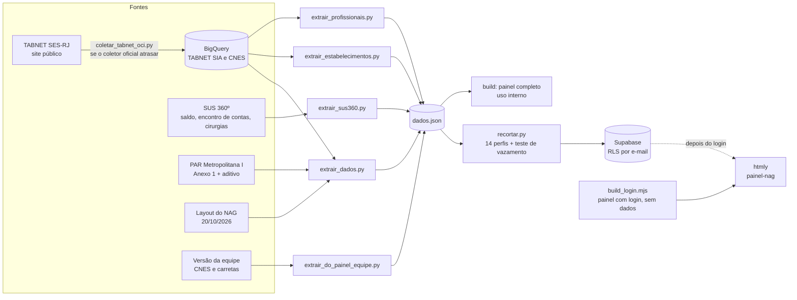

# Documentação do Painel NAG · Agora Tem Especialistas

**Metropolitana I (RJ) · Núcleo de Apoio à Gestão (NAG) · CISBAF**

| | |
|---|---|
| Publicação | painel-nag.htmly.com.br, com **login por e-mail e senha**: cada usuário vê só o que o seu acesso libera |
| Versão desta documentação | 06/11/2026 |
| Produção de OCI coberta | jan/25 a ago/26 (ago/26 ainda recebe aprovações) |
| Saldo do gestor (encontro de contas) | SUS 360º, competência 07/2026 (release de 12/09/2026) |
| TABNET SIA (OCI) | BigQuery, coleta de 04/11/2026, até ago/26 |
| Totais desta versão | 144.637 OCI aprovadas (jan/25 a ago/26) e 183.652 cirurgias do programa (SUS 360º, até jul/26) |
| Referência do Conselho Técnico (18/10/2026) | 127.029 OCI e 183.652 cirurgias, de jan/25 a jul/26, com os dados daquela data |
| Financeiro do PAR | R$ 125.457.945,41 nos 12 municípios (Anexo 1 do PAR e do aditivo de ginecologia) |
| Atualização | automática, uma vez por semana (seção 13) |

---

## Sumário

1. [Para que serve](#1-para-que-serve)
2. [Como usar](#2-como-usar)
3. [Mapa das páginas](#3-mapa-das-páginas)
4. [Página por página](#4-página-por-página)
5. [Fontes de dados](#5-fontes-de-dados)
6. [Conceitos e regras que valem para todo o painel](#6-conceitos-e-regras-que-valem-para-todo-o-painel)
7. [Indicadores e fórmulas](#7-indicadores-e-fórmulas)
8. [Critérios dos alertas](#8-critérios-dos-alertas)
9. [Pontos a confirmar](#9-pontos-a-confirmar)
10. [Estrutura técnica](#10-estrutura-técnica)
11. [Acesso, usuários e LGPD](#11-acesso-usuários-e-lgpd)
12. [Histórico de versões](#12-histórico-de-versões)
13. [Como atualizar](#13-como-atualizar)

---

## 1. Para que serve

O Programa Agora Tem Especialistas (Lei nº 15.233/2025) busca encurtar a espera por consulta, exame e cirurgia com especialista. O Ministério da Saúde **adianta o dinheiro**, e os 12 municípios da Metropolitana I **comprovam com atendimentos registrados e aprovados no SUS**.

O painel responde a quatro perguntas, na ordem do menu:

1. **O que foi pactuado?** Metas físicas e financeiras do PAR e catálogo de OCI.
2. **O que foi produzido?** OCI e cirurgias aprovadas, ritmo e migração.
3. **O que foi pago?** Dinheiro adiantado × comprovado.
4. **Onde se perde?** Alertas, habilitações sem produção e o que ainda não vira pagamento.

Ele é usado como pauta das visitas do NAG aos municípios e nas apresentações ao Conselho Técnico do CISBAF. Desde 03/11/2026, cada secretaria municipal pode ter o próprio login e ver só o seu município, com a região apenas em totais, médias e posição.

## 2. Como usar

- **Entrar:** e-mail e senha fornecidos pelo NAG. "Manter conectado neste computador" evita digitar a senha a cada visita. O botão **Sair** fica no rodapé do menu.
- **Filtro do topo:** escolha o **município** e o período (**De / Até**). O filtro vale para todas as páginas. No login de um município, o município fica fixo.
- **Clique num mês** do gráfico de evolução para fixar o período nele. Clique de novo para voltar.
- **Clique num município** (num quadro ou numa linha de tabela) para filtrar o painel inteiro. O **×** no filtro ativo desfaz.
- **Passe o mouse** nas barras, pontos e células para ver valores, variação e posição.
- **☾** alterna entre o modo claro e o escuro.
- Cada página tem: **O que mostra / Por que importa**, **Palavras desta página** (glossário) e, no rodapé, **Fontes, normas e regras desta página**.
- O rodapé do menu mostra a data de cada fonte e quando o painel foi gerado. Depois de uma atualização, recarregue a página (F5).

## 3. Mapa das páginas

| Grupo | Página | Endereço interno | Situação |
|---|---|---|---|
| Comece aqui | Início | `#/inicio` | ativa (consolidado físico e financeiro do PAR desde 05/11/2026) |
| O que foi pactuado | PAR e metas | `#/pactuado/par` | ativa (financeiro oficial do PAR desde 04/11/2026) |
| O que foi pactuado | Catálogo de OCI | `#/pactuado/catalogo` | ativa |
| O que foi produzido | Produção de OCI | `#/produzido/oci` | ativa |
| O que foi produzido | Curva de aprendizado | `#/produzido/curva` | ativa |
| O que foi produzido | Cirurgias do programa | `#/produzido/cirurgias` | ativa |
| O que foi produzido | Quais cirurgias entram | `#/produzido/quais` | ativa |
| O que foi produzido | Migração das OCI | `#/produzido/mig_oci` | ativa (com mapa) |
| O que foi produzido | Migração das cirurgias | `#/produzido/mig_cir` | ativa (com mapa) |
| O que foi pago | Encontro de contas | `#/pago/encontro` | ativa (saldo por componente e propostas) |
| O que foi pago | TABNET × SUS 360º | `#/pago/confronto` | ativa |
| Onde se perde | Alertas | `#/perde/alertas` | ativa |
| Onde se perde | Atendido e não faturado | `#/perde/nao_faturado` | planejada |
| Onde se perde | Potencial de OCI | `#/perde/potencial` | planejada |
| Onde se perde | CNES e habilitações | `#/perde/cnes` | ativa (médicos e Portaria 134 desde 03/11/2026) |
| Relatório do município | Relatório do município | `#/relatorio` | ativa (para imprimir ou salvar em PDF) |
| Usuários | Usuários e acessos | `#/usuarios` | ativa, **só para o gestor** |
| Nota metodológica | Fontes, regras e pendências | `#/nota` | ativa |

## 4. Página por página

### Comece aqui

- **No topo:** três números-resumo:
  - **Quantidade de OCI ambulatorial aprovada**, de jan/25 até o último mês;
  - **Cirurgias do programa**;
  - **Falta do encontro de contas**: o adiantamento ainda sem comprovação, com o total adiantado e o prazo de 31/12/2026.
- **Bloco "PAR: físico e financeiro":** os mesmos 8 cards da página PAR e metas (seção abaixo), para a região ou, no login de um município, só para ele.
- **Também na página:** os atalhos para cada bloco, o "Como usar" e os avisos "Antes de ler os números". No login de um município entra ainda a referência da região: total, média e posição do município.

### O que foi pactuado › PAR e metas

- **O que mostra:** quanto de cada OCI o município pactuou no Plano de Ação Regional, quanto isso vale em reais e quanto já fez, somando desde o início do programa até o mês escolhido.
- **Por que importa:** o PAR é o compromisso do município com o Ministério. A meta vale para o plano inteiro: o que importa é o caminho percorrido até agora, não o mês isolado.
- **Cards**, em duas linhas:

  | | Coluna 1 | Coluna 2 | Coluna 3 | Coluna 4 |
  |---|---|---|---|---|
  | **Linha 1** | Meta física do PAR | Financeiro do PAR (R$) | Quantidade de OCI ambulatorial aprovada até o "Até" | Valor aprovado até o "Até" (R$) |
  | **Linha 2** | Da meta física cumprida (%) | Do financeiro executado (%) | Pactuadas sem nenhuma aprovação | Falta executar do PAR (R$) |
- **Quadros:**
  - **Meta × realizado por município:**
    - colunas: meta física, aprovadas e % físico, com trilho; financeiro do PAR, valor aprovado e % financeiro, com trilho; OCI com meta sem produção;
    - ordenado pelo % físico e clicável para filtrar o painel.
  - **Por área:** meta e realizado acumulado por subgrupo de OCI. Fica sem financeiro, porque o PAR só traz o financeiro por município.
  - **Pactuadas e ainda sem aprovação:** pares município × OCI com meta e zero aprovação.
- **Fontes:**
  - meta física: PAR da Metropolitana I (tabela TFísico do NAG);
  - financeiro: Anexo 1 do PAR de fev/2025 (SES-RJ) e do aditivo de ginecologia (CIB-RJ);
  - produção: TABNET SIA.

### O que foi pactuado › Catálogo de OCI

- **O que mostra:** as 52 OCI vigentes no SIGTAP e, para cada uma, se o município já realizou, se estava no PAR e ainda não saiu, ou se ficou fora do plano.
- **Por que importa:** mostra o que ainda não começou. Uma portaria nova que cria OCI faz a OCI aparecer aqui com zero até o primeiro paciente ser aprovado.
- **Indicadores:** Quantidade de OCI ambulatorial aprovada no período · Já realizadas · No PAR, sem produção · Fora do PAR.
- **Filtros locais:** Situação e Área.

### O que foi produzido › Produção de OCI

- **O que mostra:** quantas OCI foram aprovadas, mês a mês, em cada área do cuidado, e os atendimentos das carretas (CMD).
- **Por que importa:** só conta o que foi registrado e aprovado no SIA. OCI feita e não registrada não aparece e não comprova o dinheiro recebido.
- **Indicadores:** Quantidade de OCI ambulatorial aprovada · Média mensal dos 3 últimos meses · Último trimestre × anterior · Valor aprovado no SIA.
- **Fonte:** TABNET SIA no BigQuery (grupo 09, mês de atendimento, município do estabelecimento); carretas: versão da equipe do NAG.

### O que foi produzido › Curva de aprendizado

- **O que mostra:** como o número de OCI cresceu desde o primeiro mês com aprovação de cada município (M1).
- **Por que importa:** mostra quem já engrenou, quem parou de crescer e quem ainda está começando, sem comparar municípios de tamanhos diferentes pelo total.
- **Fases (a confirmar):**
  - Começando: até 3 meses de produção;
  - Acelerando: +10% ou mais;
  - Desacelerando: −10% ou mais;
  - Estável: entre os dois;
  - Parado: 2 últimos meses sem OCI.

### O que foi produzido › Cirurgias do programa e Quais cirurgias entram

- **O que mostram:** cirurgias do programa aprovadas por mês, município, procedimento e estabelecimento; o rol oficial e o que de fato foi feito, por sistema de registro (AIH ou APAC).
- **Por que importa:** as cirurgias não têm meta no PAR, mas usam o mesmo dinheiro das OCI. Só conta a cirurgia que está na lista oficial e foi registrada do jeito certo.
- **Fonte:** SUS 360º, Monitor de Cirurgias (API). O sistema de registro vem do TABNET SES-RJ.
- **Norma:** Portaria SAES/MS nº 3.245/2025 (alterada pelas nº 4.182/2026 e 4.654/2026).

### O que foi produzido › Migração das OCI e Migração das cirurgias

- **O que mostram:** onde os moradores de cada município foram atendidos ou operados, no próprio município (retenção) ou em outro (migração). As páginas trazem mapa de setas entre municípios, os estabelecimentos que mais atenderam e o mapa dos estabelecimentos.
- **Por que importa:** o procedimento conta para quem atendeu e faturou, não para o município de residência. Muita migração indica falta de oferta local.
- **Fontes:**
  - OCI: TABNET SIA no BigQuery (residência × estabelecimento);
  - cirurgias: residência pelo layout do NAG e estabelecimentos pelo SUS 360º;
  - mapa: coordenadas do CNES e malha do IBGE.

### O que foi pago › Encontro de contas

- **O que mostra:** quanto o Ministério adiantou a cada município, por componente (ambulatorial, cirúrgico, parcelas suplementares e emendas), quanto já foi comprovado, a taxa de execução e cada proposta de parcela suplementar ou emenda.
- **Indicadores:** Adiantado pelo Ministério · Comprovado com OCI · Comprovado com cirurgias · Ainda sem comprovação · Ritmo necessário · Taxa de execução.
- **Por que importa:** o que não for comprovado até **31/12/2026** fica descoberto.
- **Atenção:** é uma **foto do saldo** do SUS 360º. O filtro de período não se aplica a esta página.
- **Fontes:** SUS 360º, Saldo do Gestor (API) e Encontro de Contas do PATE (arquivos de 2025 e 2026).

### O que foi pago › TABNET × SUS 360º

- **O que mostra:** os mesmos números contados nas duas fontes oficiais, onde batem, onde diferem e por quê.
- **Motivo principal da diferença:** o TABNET SES-RJ usado nesta página está por mês de processamento, e o SUS 360º por mês de atendimento. O BPA consolidado não tem município de residência.

### Onde se perde › Alertas

- **O que mostra:** uma lista do que pede atenção agora, montada com os dados das outras páginas. Serve de pauta para a visita do NAG ao município.
- **Indicadores:** Alertas · Críticos · De atenção · Municípios com algum alerta.
- **Quadros:** quadro por município (uma coluna por tipo de alerta) e lista de alertas, com os críticos primeiro. Os meses sem OCI aprovada de cada município aparecem também no Relatório do município.

### Onde se perde › CNES e habilitações

- **O que mostra:** quem está habilitado no programa (38.01 para OCI e 29.02 para cirurgias) e quem já produziu no período.
- **Médicos dos habilitados sem produção:** clique num estabelecimento das listas "Habilitados para OCI sem nenhuma OCI aprovada" ou "Habilitados para cirurgias sem cirurgia do programa aprovada". Abre ao lado a tabela dos médicos dele: cargo (CBO), vínculo, horas por mês no estabelecimento e no total, e alerta da **Portaria SAS/MS nº 134/2011**.
- **Fontes:**
  - habilitações: CNES do SUS 360º, pela versão da equipe do NAG;
  - médicos: vínculos profissionais do CNES no BigQuery, só agregados, sem nome nem CNS.

### Onde se perde › páginas planejadas

| Página | Pergunta que vai responder | Fonte | O que falta |
|---|---|---|---|
| Atendido e não faturado | Quantas OCI foram atendidas no e-SUS Regulação e não viraram APAC aprovada? | e-SUS Regulação (BigQuery) × TABNET SIA | A coleta do e-SUS estava parada desde 14/09/2026; a correção foi enviada ao repositório da Inovação. Falta definir a regra de casamento solicitação × APAC. |
| Potencial de OCI | Quais exames e consultas feitos fora das OCI poderiam ter sido faturados como OCI? | SUS 360º, Panorama Clínico × SIGTAP | O Panorama Clínico é Power BI, que recusa consulta por script. |

### Relatório do município

Relatório municipal pronto para imprimir ou salvar em PDF. Ele segue o período do filtro. As partes são:

1. **Situação do município:** linha "PAR do município" (meta física, financeiro pactuado, % físico e % financeiro executado), encontro de contas, OCI e cirurgias, e alertas.
2. OCI por área e por OCI, incluindo as pactuadas sem aprovação.
3. Cirurgias.
4. Origem dos recursos e encontro de contas por fonte.
5. Propostas.
6. CNES e habilitações.

### Usuários (só para o gestor)

Aparece só para quem entra como gestor. Permite:

- criar o login de um município: e-mail e senha gerada, mostrada uma única vez;
- trocar senha;
- mudar papel ou município;
- remover acesso.

Tudo fica registrado em "Últimas alterações", sem senhas. Detalhes na seção 11.

### Nota metodológica

Reúne as fontes, a data de atualização de cada uma, as regras aplicadas, os avisos da última conferência e os pontos a confirmar.

## 5. Fontes de dados

| Fonte | O que traz | Atualização nesta versão | Situação |
|---|---|---|---|
| TABNET SIA, no BigQuery | OCI aprovadas e apresentadas por estabelecimento, OCI e mês de atendimento; migração residência × estabelecimento | até ago/26, coleta de 04/11/2026 | integrada |
| TABNET SES-RJ (site público) | Mesma produção, direto da fonte, quando o coletor oficial atrasa | sob demanda (seção 13) | integrada |
| SUS 360º · Saldo do Gestor (API) | Recursos antecipados, comprovados, saldo e pós-produção por componente | competência 07/2026, release de 12/09/2026 | integrada |
| SUS 360º · Encontro de Contas do PATE | Parcelas suplementares e emendas por proposta | 2025 e 2026 | integrada |
| SUS 360º · Monitor de Cirurgias (API) | Cirurgias do programa por procedimento, estabelecimento e mês | até jul/26 | integrada |
| CNES, no BigQuery | Ficha dos estabelecimentos (nome, tipo, gestão, coordenadas) e vínculos profissionais (cargo, vínculo, horas) | competência 08/2026 | integrada |
| PAR da Metropolitana I | Meta física por OCI e município (tabela TFísico do NAG) | quando houver reprogramação | integrada (layout do NAG) |
| PAR da Metropolitana I · Anexo 1 | Financeiro por município: PAR de fev/2025 (SES-RJ, ajuste à Portaria SAES/MS nº 2.331) e aditivo de ginecologia (CIB-RJ, Portaria GM/MS nº 7.273/2025) | quando houver reprogramação | integrada |
| Versão da equipe do NAG | Habilitações 38.01 e 29.02, médicos e horas SUS, terceirizados, carretas (CMD) | 29/10/2026 | integrada (ponte) |
| Layout do NAG (20/10/2026) | Catálogo das 52 OCI, população, migração das cirurgias por residência, TABNET SES-RJ do confronto | 20/10/2026 | provisória |
| IBGE | Censo 2022 (população) e malha dos municípios (mapa) | 2022 | integrada |
| SIGTAP, no BigQuery | Detalhe das OCI | coleta de 02/11/2026 veio vazia | não usado: o catálogo segue do layout |
| e-SUS Regulação, no BigQuery | Solicitações e atendimentos | parada desde 14/09/2026 | pendente |
| SUS 360º · OCI (SIA + CMD) e Panorama Clínico | Produção de OCI pela visão do SUS 360º; potencial de OCI | — | bloqueada (Power BI recusa script) |

## 6. Conceitos e regras que valem para todo o painel

Estes conceitos são fixos: o layout pode mudar, eles não.

1. **Município** = o município do **estabelecimento que atendeu e faturou**. Nas páginas de migração entra também o de **residência**.
2. **Mês:** a produção de OCI (TABNET SIA no BigQuery) e o SUS 360º usam o **mês do atendimento**. O TABNET SES-RJ da página de confronto usa o **mês de processamento**.
3. **Último mês parcial:** o último mês da base ainda recebe aprovações tardias. Ele aparece com **\*** e toda variação que o inclui também leva **\***.
4. **Último trimestre** = os 3 meses que terminam no "Até", comparados com os 3 anteriores.
5. **PAR acumulado:** o realizado (físico e financeiro) é **acumulado desde o início da base até o "Até"** e comparado com a **meta do plano inteiro**.
6. **Financeiro do PAR** = valor pactuado por gestor municipal no Anexo 1 do PAR e do aditivo. A parte do Estado do Rio de Janeiro (R$ 274.157,66; 983 OCI de oncologia e 352 de ortopedia) fica de fora, como na meta física.
7. **Curva de aprendizado:** cada município começa no **seu** primeiro mês com OCI aprovada (M1).
8. **Encontro de contas** é uma **foto** do SUS 360º e não muda com o período. O prazo é **31/12/2026**.
9. **Só conta o que foi aprovado** (SIA ou SIH). Produção não registrada não comprova o adiantamento.
10. **Filtro global:** município e período valem para todas as páginas. No login de um município, o município é fixo.

## 7. Indicadores e fórmulas

| Indicador | Fórmula | Fonte | Página |
|---|---|---|---|
| Da meta física cumprida | OCI aprovadas acumuladas até o "Até" ÷ meta física do PAR × 100 | TABNET SIA; PAR | Início; PAR e metas; Relatório |
| **Financeiro do PAR** | Soma do valor pactuado dos gestores do recorte (Anexo 1) | PAR e aditivo | Início; PAR e metas; Relatório |
| **Valor aprovado** | Σ (OCI aprovadas × valor unitário da OCI no PAR), acumulado até o "Até"; OCI fora do PAR (nefrologia) pelo SIGTAP | TABNET SIA; PAR | Início; PAR e metas |
| **Do financeiro executado** | Valor aprovado ÷ financeiro do PAR × 100 | idem | Início; PAR e metas; Relatório |
| **Falta executar do PAR** | Financeiro do PAR − valor aprovado (mínimo zero) | idem | Início; PAR e metas |
| Pactuadas sem aprovação | Nº de pares município × OCI com meta > 0 e zero aprovação até o "Até" | PAR; TABNET SIA | PAR e metas; Alertas |
| Média mensal, 3 últimos meses | Soma dos 3 meses que terminam no "Até" ÷ 3 | TABNET SIA; SUS 360º | Produção; Cirurgias |
| Último trimestre × anterior | (média dos 3 últimos ÷ média dos 3 anteriores) − 1 | idem | Produção; Curva |
| Retenção | Procedimentos de residentes feitos no próprio município ÷ total de procedimentos de residentes × 100 | TABNET | Migração |
| Falta do encontro de contas | Adiantado − comprovado (OCI + cirurgias), no saldo do SUS 360º | SUS 360º Saldo | Início; Encontro de contas |
| Meses sem OCI aprovada | Nº de meses, entre a 1ª aprovação do município e o "Até", com zero OCI aprovada | TABNET SIA | Alertas; Relatório |
| Taxa de execução | Produção aprovada ÷ recursos recebidos, no saldo do SUS 360º | SUS 360º Saldo | Encontro de contas |
| Ritmo necessário | Falta comprovar ÷ meses de competência até dez/26 | SUS 360º Saldo | Encontro de contas |
| Horas por mês do médico | Carga horária semanal × 52 ÷ 12, no estabelecimento e somando todos os vínculos | CNES (vínculos) | CNES e habilitações |

**Valor unitário do PAR:** o preço de cada OCI usado no valor aprovado é o mesmo das tabelas do PAR. Para algumas OCI ele difere do SIGTAP atual. Na ortopedia com ressonância (09.03.01.004-6), por exemplo, o PAR usa R$ 360,00 e o SIGTAP R$ 616,76; nas OCI de câncer gástrico e colorretal, o PAR usa R$ 250,00 e R$ 282,00. Por isso meta × SIGTAP (R$ 157,1 mi) não é o financeiro do PAR (R$ 125,46 mi).

## 8. Critérios dos alertas

Critérios propostos, **A CONFIRMAR com o NAG**.

| Alerta | Nível | Critério |
|---|---|---|
| Sem OCI nos 2 últimos meses | Crítico | Nenhuma OCI aprovada nos 2 últimos meses até o "Até" |
| Menos de 20% do adiantamento comprovado | Crítico | Produção ÷ adiantamento < 20% no saldo do SUS 360º |
| Queda de OCI acima de 20% no trimestre | Atenção | Média dos 3 últimos meses pelo menos 20% abaixo dos 3 anteriores |
| Queda de cirurgias acima de 20% no trimestre | Atenção | Idem, para cirurgias |
| Meses sem OCI depois de começar | Atenção | Mês com zero OCI depois da 1ª aprovação, sem contar os 2 últimos |
| OCI pactuada sem nenhuma aprovação | Atenção | OCI com meta no PAR e nenhuma aprovação até o "Até" |
| Retenção de cirurgias abaixo de 50% | Atenção | Menos da metade dos moradores operados no próprio município |

Fora da página Alertas:

| Alerta | Onde | Critério |
|---|---|---|
| Habilitado sem produção | Relatório do município; CNES e habilitações | Estabelecimento habilitado (38.01 ou 29.02) sem nenhuma aprovação no período |
| Portaria 134, art. 2º | CNES e habilitações (no médico) | Mais de 2 cargos ou empregos públicos no CNES |
| Portaria 134, art. 3º | CNES e habilitações (no médico) | Autônomo em mais de 5 estabelecimentos não públicos |

A Portaria SAS/MS nº 134/2011 **não fixa teto de horas**, e o painel não inventa um. A carga horária aparece para leitura, sem alerta próprio.

## 9. Pontos a confirmar

1. **Vigência do PAR** e eventuais reprogramações depois do aditivo de ginecologia (junho de 2025). Se a meta física mudar, o financeiro sai do painel até a referência ser refeita (seção 13).
2. **Critérios de fases e alertas** (±10% na tendência, 2 meses sem OCI, queda acima de 20%).
3. **Residentes operados:** o Conselho Técnico cita 87.588 pessoas, mas a base agregada só tem cirurgias, não pessoas distintas.
4. **CMD (carretas):** os atendimentos aparecem na Produção de OCI, a partir da versão da equipe.
5. **Vínculos do CNES:** em 41 estabelecimentos, a base de vínculos do BigQuery (08/2026) tem bem menos médicos que a contagem da versão da equipe (09/2026). A tabela avisa quando a diferença é grande.
6. **Taxa de execução** na versão da equipe, a confirmar com a equipe.
7. **Estabelecimentos fora do mapa:** 16 estabelecimentos aguardam a escolha entre duas propostas de coordenadas (13 ou 15 pontos).
8. **SIGTAP do BigQuery:** a coleta de 02/11/2026 veio vazia. O catálogo segue do layout do NAG até a coleta voltar.

Resolvido nesta versão: o **valor financeiro do PAR em Oncologia**, pendente desde 22/10/2026. O financeiro agora vem do Anexo 1 oficial, e o total fecha com os R$ 125,5 mi do relatório do NAG.

## 10. Estrutura técnica

### Como o painel é montado

- **Aplicação:** React com Vite, gráficos próprios, GSAP e Three.js (ícones 3D), tudo embutido num HTML único, sem CDN.
- **O HTML publicado não tem dado nenhum.** Depois do login, ele busca no banco Supabase do CISBAF só o pedaço liberado para aquele e-mail (seção 11).
- **Dado único:** todos os scripts gravam o mesmo arquivo, `dados.json`. Ele é recortado em 14 perfis (gestor, regional e um por município) e carregado no banco. A carga é atômica: ou entra inteira ou o banco fica com a anterior.

### Fluxo da atualização

### Campos do `dados.json`

| Grupo | Campos | Conteúdo | Fonte |
|---|---|---|---|
| Base | `mun`, `pop`, `meses` | Os 12 municípios (a posição é o índice das demais tabelas), população e competências (2025-01 a 2026-08) | layout; período estendido pelo BigQuery |
| Catálogos | `cat`, `subs`, `procs`, `pcls`, `lista`, `lcls`, `psys`, `tproc` | OCI do SIGTAP; procedimentos cirúrgicos e sistema de cada um | layout + SUS 360º |
| OCI | `oci`, `meta` | `[município, OCI, mês, qtd, valor, CNES]`; `[município, OCI, meta física]` | TABNET SIA; PAR |
| **PAR financeiro** | `par_fin` | `{município: R$ pactuado}` | Anexo 1 do PAR e do aditivo |
| Cirurgias | `cir`, `est`, `cirest` | `[município, procedimento, mês, qtd, valor]`; estabelecimentos; `[município, estabelecimento, mês, qtd]` | SUS 360º |
| Migração | `ofnomes`/`ofluxo`, `fnomes`/`fluxo`, `tsia`, `tsih`, `tsiaapac`, `tsiabpa` | `[residência, atendimento, mês, qtd]` | TABNET SIA (BigQuery); cirurgias e SES-RJ: layout |
| Estabelecimentos | `oest`, `oestfluxo`, `geo` | OCI por estabelecimento × residência; cadastro com coordenadas | TABNET SIA + CNES |
| Dinheiro | `ec`, `ec_atual`, `saldo`, `propostas` | Saldo por município e por componente; uma linha por proposta × CNES | SUS 360º |
| CNES e carretas | `hab`, `prof`, `terc`, `cnes_comp`, `carr`, `carr_atual` | Habilitações; médicos e horas SUS; terceirizados; carretas por município e mês | versão da equipe |
| **Médicos** | `med`, `med_cbo`, `med_vinc`, `med_comp` | `{CNES: [[cargo, horas aqui, SUS, vínculo, horas total, nº estab., nº públicos, nº autônomo privado, alerta]]}` (alerta: 1 = Portaria 134 art. 2º, 2 = art. 3º); sem nome, CNS ou CPF | CNES (BigQuery) |
| Metadado | `info` | Data de geração, origem de cada campo, avisos da conferência, datas das fontes | os scripts |
| Só nos perfis | `perfil`, `regiao`, `ref` | Tipo de perfil; os 12 nomes; referência da região já agregada (total, média e posição) | recortar.py |

Campo novo no `dados.json` exige uma regra no recorte por município. Sem ela, o teste de vazamento reprova a carga.

## 11. Acesso, usuários e LGPD

### Perfis

| Papel | Vê | Gerencia usuários |
|---|---|---|
| **Gestor** (NAG) | Os 12 municípios | sim (aba Usuários) |
| **Regional** | Os 12 municípios | não |
| **Municipal** | Só o próprio município. Saldo, propostas, PAR (meta e financeiro) e médicos são só dele. Estabelecimentos de fora aparecem só com o que atenderam dos moradores dele. A região aparece só agregada (total, média e posição) | não |

### Como funciona

- Cada pessoa entra com e-mail e senha. O banco entrega **só** a linha do perfil liberado para aquele e-mail (Row Level Security). O dado de um município vizinho não fica escondido na tela: ele nunca sai do banco para quem não tem acesso.
- O NAG cria e remove acessos pela aba **Usuários**. A aba chama uma função no servidor, que confere se quem pede é gestor; a chave secreta do banco nunca vai para o navegador. Não dá para remover o próprio acesso nem o último gestor.
- A carga de dados só é aceita com uma chave de carga que fica na máquina que atualiza; no banco fica só o hash dela.
- O painel só tem **números agregados**, sem dado nominal. A base de vínculos do CNES é agregada por profissional dentro do BigQuery, sem ler nome, CNS, CPF ou identificador. As tabelas de contato de paciente do e-SUS nunca são consultadas linha a linha.
- **Nunca publicar em link aberto** uma versão que tenha dado nominal do e-SUS ou do CNES.

### Versões sem internet

Para enviar a uma secretaria sem internet, existem versões offline por perfil (um HTML por município, já recortado). Duas barreiras automáticas conferem que o arquivo de um município não traz dado de outro.

## 12. Histórico de versões

| Data | Versão | O que mudou |
|---|---|---|
| 20/10/2026 | Layout NAG original | Dez páginas: Comece aqui, Produção de OCI, Catálogo, Curva de aprendizado, Cirurgias do programa, Quais cirurgias entram, Migração das OCI, Migração das cirurgias, TABNET × SUS 360º e Encontro de contas. |
| 21/10/2026 | Painel reformulado | Reorganizado em 5 blocos (pactuado, produzido, pago, onde se perde, nota). Novas páginas: PAR e metas e Alertas. |
| 22/10/2026 | Financeiro do PAR e competências | Primeiro financeiro do PAR (meta × SIGTAP, com a ressonância a R$ 360,00) e quadro "Competências sem OCI aprovada". |
| 29/10/2026 | SUS 360º automático | Saldo do gestor, propostas e cirurgias lidos direto das APIs do SUS 360º. Entram, a partir da versão da equipe, as páginas CNES e habilitações e Relatório do município, o quadro das carretas e o mapa de setas da migração. |
| 03/11/2026 | Login e acesso por município | Painel 3D publicado no htmly sem dados, com login. Os dados vêm de um banco com RLS por e-mail (gestor, regional e um perfil por município). Aba Usuários para o gestor. Na página CNES, a tabela de médicos dos habilitados sem produção, com o alerta da Portaria 134/2011. |
| 04/11/2026 | Agosto de 2026 e financeiro oficial do PAR | TABNET 08/2026 no BigQuery, com coleta direta do site da SES-RJ e aprovações tardias de 05 a 07/2026. O período do painel passa a seguir o BigQuery. Financeiro do PAR pelo Anexo 1 oficial (R$ 125.457.945,41); oncologia resolvida. Cards: valor aprovado, % financeiro executado e falta executar. |
| 05/11/2026 | Página inicial consolidada | O Início ganhou o bloco "PAR: físico e financeiro" com os 8 cards da PAR e metas. A tabela por município da PAR e metas ganhou o financeiro. No perfil municipal e no Relatório entram a meta física e o financeiro pactuado. Rótulos novos: "Quantidade de OCI ambulatorial aprovada" e "Falta do encontro de contas". |
| 06/11/2026 | Atualização automática | Rodada semanal sem intervenção, com travas: qualquer falha numa fonte mantém o painel online como estava. Esta documentação foi atualizada. |

## 13. Como atualizar

### Automático (padrão)

Uma tarefa agendada no Windows da máquina do NAG que atualiza o painel roda o atualizador **uma vez por semana**. Ela tenta todo dia às 13h e no logon, e recupera a rodada se a máquina estava desligada. A cada rodada:

1. **TABNET:** se o TABNET SES-RJ já tiver um mês que o BigQuery não tem, porque o coletor oficial atrasou, ele recoleta a produção e a migração de OCI direto do site e regrava os arquivos do data lake. Guarda backup e não grava nada se algum par sumir ou se a migração não fechar com a produção.
2. **Fontes:** lê o BigQuery, o SUS 360º, o CNES, a versão da equipe e os vínculos profissionais.
3. **Trava de regressão:** o período não pode encolher e as OCI e cirurgias não podem cair mais de 1%.
4. **Carga:** monta o painel, recorta os 14 perfis, passa no teste de vazamento e carrega no banco, conferindo perfil a perfil.

**Se qualquer fonte falhar, a rodada para e o painel online fica como estava.** A tentativa se repete no dia seguinte. As causas mais comuns são credencial do Google vencida, SUS 360º fora do ar e falta de internet. A máquina guarda o log de cada rodada e cria um aviso "ATENÇÃO" quando a última falhou.

O htmly **não** precisa ser republicado quando só os dados mudam: o painel publicado busca os dados no banco a cada login.

### Manual

- **Atualizar agora:** rodar `atualizar_painel.bat` com dois cliques, ou o atualizador automático com a opção de forçar.
- **Republicar no htmly:** só quando o **código** do painel muda (página nova, correção de tela).
- **PAR reprogramado:** se a meta física mudar, a atualização avisa e o financeiro do PAR aparece como "—". Para corrigir, transcrever o Anexo 1 do PAR novo para o arquivo de referência do financeiro e rodar de novo.
- **Versão nova da equipe do NAG:** salvar o arquivo na pasta de referência com a data no nome e rodar a atualização.

### Esta documentação

A cada versão:

1. Acrescentar uma linha no histórico (seção 12).
2. Atualizar fontes, fórmulas e pendências.
3. Levar os indicadores novos (por exemplo, financeiro do PAR, % do financeiro executado, falta executar e alertas da Portaria 134) para o `Dicionario_de_Dados_Observatorio.xlsx`, abas Variáveis e Indicadores.
